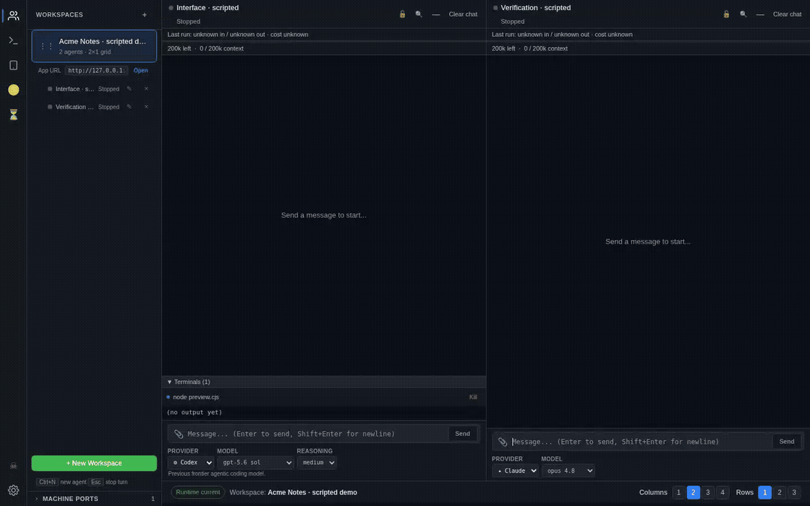
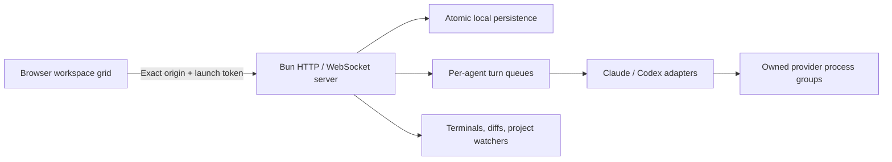

# Agent Forge

Supervise parallel coding agents as a daily engineering workflow: separate tasks, shared project context, real terminals, and human review before integration.

[](https://github.com/Brian-Coding/Agent-Forge/actions/workflows/ci.yml)
[](LICENSE)

**Try it without AI accounts:** `bun install --frozen-lockfile` then `bun run demo`. Open the printed URL and send a message in either pane. The disposable Acme Notes workspace uses scripted stand-ins; terminal tests and the preview server are real. Ctrl+C cleans up. Repository access is required while this preview is private.



*Linux recording of the running app, fictional data, scripted stand-ins, no model calls. [MP4](docs/images/forge-demo.mp4) · [Reproduce the recording](docs/media.md).*

**Engineering evidence:** [Architecture](docs/architecture.md) · [Failure modes + tests](docs/FAILURE-MODES.md) · [Decisions](docs/decisions/README.md) · [Team rollout](docs/ADOPTION.md)



## Why this matters for teams adopting AI

Split a change into bounded implementation and verification tasks, give each writer a separate Git worktree, and supervise their progress in one grid. Per-agent queues, session ownership, exact-origin/token checks and owned-process cleanup keep the workbench predictable. Provider-reported last-run tokens/cost are visible; missing values say unknown.

Humans still define acceptance criteria, review diffs, run independent checks and approve merges/releases. Forge does not verify an agent’s claim that tests passed, sandbox its shell, or enforce a spending cap. Start with two tasks in week 1, shadow existing reviews in week 2, then expand only if review effort and defects improve. The [three-week playbook](docs/ADOPTION.md) makes approval points explicit.

## What you can do

- **Run many agents at once.** Put Claude and Codex agents in a resizable grid, give each its own project folder, model, reasoning level, and persona, and switch providers while keeping the visible chat history. Provider/model or project changes start a fresh provider session.
- **Chat with real progress.** Markdown replies, live "thinking" and tool activity, elapsed time, stall detection, queued follow-ups, retries, and up to 100 image attachments per message.
- **Organize by workspace.** Group agents per project, lock panes in place, drag to rearrange, and keep an App URL handy for the thing you are building.
- **Share instructions.** Built-in safety guardrails apply to every turn; add your own shared project instructions on top, and agents pick up `.plans/*.md` files from the project automatically.
- **Stay close to the code.** See which files an agent changed, open the Git diff, check the branch, and run commands in per-agent terminals.
- **Keep the machine tidy.** See which local ports are in use and by what, stop stray dev servers, and manage iOS simulators on macOS.
- **Watch usage and limits.** Token usage by agent, model, and day, plus Claude and Codex rate-limit windows.
- **Stay local.** The server binds to `127.0.0.1`, checks Host/Origin headers, and uses guarded, quarantine-first file operations for anything it deletes itself.

## Requirements

- [Bun](https://bun.sh/) 1.4.4 or newer (the tested version)
- Node.js 20+ for the account-free demo and browser checks; Linux port inventory needs `lsof` or `ss`.
- For real agents, at least one provider CLI installed and signed in:
  - [Claude Code](https://docs.anthropic.com/en/docs/claude-code) (`claude`)
  - [Codex CLI](https://github.com/openai/codex) (`codex`)
- Linux is tested here. macOS and Windows paths exist; native validation remains outstanding.

## Quick start

**Private preview:** cloning requires repository access. Use the account-free demo above first; the following starts your real provider workflow.

```bash
git clone https://github.com/Brian-Coding/Agent-Forge.git
cd Agent-Forge
bun install --frozen-lockfile
bun run dev
```

Open the URL the server prints (normally <http://127.0.0.1:3333>). Create a workspace, pick its project folder, then click **+ Add Agent**.

See [Getting started](docs/getting-started.md) for a guided first session.

The browser dependencies are bundled locally from `bun.lock`; no CDN is required. Provider CLIs and the server's provider model/usage endpoints need network access. See [network and safety boundaries](docs/safety.md).

## Documentation

- [Getting started](docs/getting-started.md)
- [Workspaces and agents](docs/workspaces-and-agents.md)
- [Chat, plans, and shared instructions](docs/chat-and-instructions.md)
- [Terminals, ports, Git, and simulators](docs/tools.md)
- [Usage and limits](docs/usage-and-limits.md)
- [Configuration](docs/configuration.md)
- [Safety model](docs/safety.md)
- [Architecture and tradeoffs](docs/architecture.md)
- [Failure modes and regression evidence](docs/FAILURE-MODES.md)
- [Architecture decisions](docs/decisions/README.md)
- [Team adoption playbook](docs/ADOPTION.md)
- [Reproducible demo and media](docs/media.md)
- [Measured performance and regression checks](docs/performance.md)
- [Changelog](CHANGELOG.md)
- [Windows launcher](docs/windows-launcher.md)

## Important: agents run with broad permissions

Agent Forge launches Claude Code and Codex in non-interactive mode with their permission prompts turned off, so agents can edit files and run commands in the folders you give them. Point agents at projects under version control, review their changes, and read the [safety model](docs/safety.md) before using it on anything you cannot recover.

## Related project

UI Atlas and the browser/app QA tester that used to live inside Agent Forge are now a separate project: [AI-UI-Atlas-QA-Tester](https://github.com/Brian-Coding/AI-UI-Atlas-QA-Tester).

## Contributing

Bug reports and pull requests are welcome. Start with [CONTRIBUTING.md](CONTRIBUTING.md); if you are a coding agent, read [AGENTS.md](AGENTS.md).

## License

[MIT](LICENSE)
