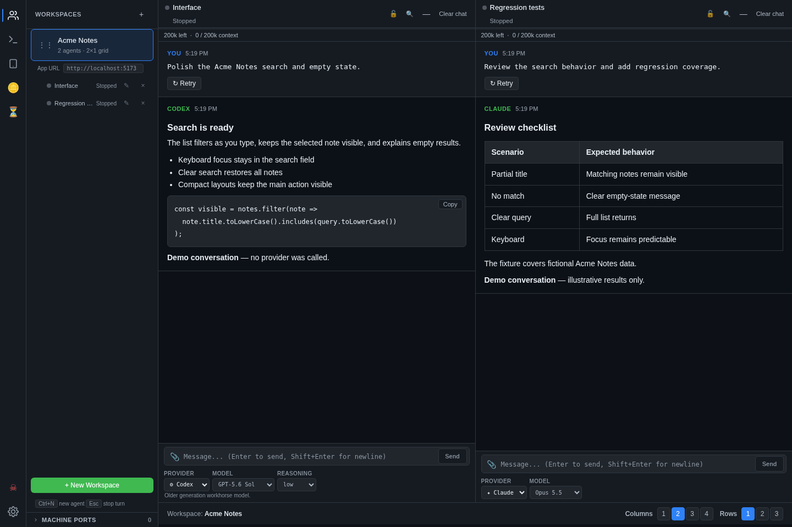
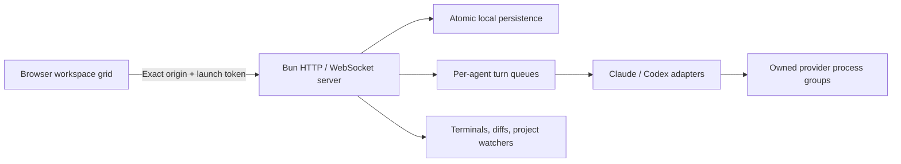

# Agent Forge

A local workbench for supervising Claude Code and Codex across several projects. Keep conversations, queued turns, terminals, diffs, and usage together in a workspace grid.

The engineering focus is reliable orchestration: validated commands, durable state, provider adapters, reconnect-safe queues, and bounded process cleanup. Provider agents still run with broad local permissions; this is a workbench for trusted development projects, not a sandbox.



*Captured from the running app on Linux with fictional demo data. No model was called for this screenshot.*



## What you can do

- **Run many agents at once.** Put Claude and Codex agents in a resizable grid, give each its own project folder, model, reasoning level, and persona, and switch providers while keeping the visible chat history. Provider/model or project changes start a fresh provider session.
- **Chat with real progress.** Markdown replies, live "thinking" and tool activity, elapsed time, stall detection, queued follow-ups, retries, and up to 100 image attachments per message.
- **Organize by workspace.** Group agents per project, lock panes in place, drag to rearrange, and keep an App URL handy for the thing you are building.
- **Share instructions.** Built-in safety guardrails apply to every turn; add your own shared project instructions on top, and agents pick up `.plans/*.md` files from the project automatically.
- **Stay close to the code.** See which files an agent changed, open the Git diff, check the branch, and run commands in per-agent terminals.
- **Keep the machine tidy.** See which local ports are in use and by what, stop stray dev servers, and manage iOS simulators on macOS.
- **Watch usage and limits.** Token usage by agent, model, and day, plus Claude and Codex rate-limit windows.
- **Stay local.** The server binds to `127.0.0.1`, checks Host/Origin headers, and uses guarded, quarantine-first file operations for anything it deletes itself.

## Requirements

- [Bun](https://bun.sh/) 1.4.4 or newer (the tested version)
- At least one provider CLI, installed and signed in:
  - [Claude Code](https://docs.anthropic.com/en/docs/claude-code) (`claude`)
  - [Codex CLI](https://github.com/openai/codex) (`codex`)
- macOS, Linux, or Windows

## Quick start

**Private preview:** this repository remains private. The commands below require repository access. Publication will use a new repository after its owner creates and seeds it; the clone URL will be updated then. No public repository is implied by these instructions.

```bash
git clone https://github.com/Brian-Coding/Agent-Forge.git
cd Agent-Forge
bun install --frozen-lockfile
bun run dev
```

Open the URL the server prints (normally <http://127.0.0.1:3333>). Create a workspace, pick its project folder, then click **+ Add Agent**.

See [Getting started](docs/getting-started.md) for a guided first session.

The browser dependencies are bundled locally from `bun.lock`; no CDN is required. Provider CLIs and the server's provider model/usage endpoints need network access. See [network and safety boundaries](docs/safety.md).

## Documentation

- [Getting started](docs/getting-started.md)
- [Workspaces and agents](docs/workspaces-and-agents.md)
- [Chat, plans, and shared instructions](docs/chat-and-instructions.md)
- [Terminals, ports, Git, and simulators](docs/tools.md)
- [Usage and limits](docs/usage-and-limits.md)
- [Configuration](docs/configuration.md)
- [Safety model](docs/safety.md)
- [Architecture](docs/architecture.md)
- [Measured performance and regression checks](docs/performance.md)
- [Changelog](CHANGELOG.md)
- [Windows launcher](docs/windows-launcher.md)

## Important: agents run with broad permissions

Agent Forge launches Claude Code and Codex in non-interactive mode with their permission prompts turned off, so agents can edit files and run commands in the folders you give them. Point agents at projects under version control, review their changes, and read the [safety model](docs/safety.md) before using it on anything you cannot recover.

## Related project

UI Atlas and the browser/app QA tester that used to live inside Agent Forge are now a separate project: [AI-UI-Atlas-QA-Tester](https://github.com/Brian-Coding/AI-UI-Atlas-QA-Tester).

## Contributing

Bug reports and pull requests are welcome. Start with [CONTRIBUTING.md](CONTRIBUTING.md); if you are a coding agent, read [AGENTS.md](AGENTS.md).

## License

[MIT](LICENSE)
